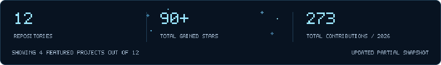
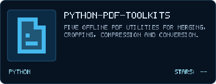
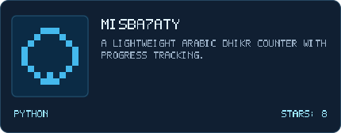
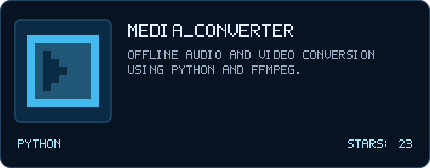
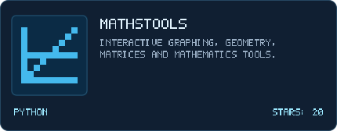
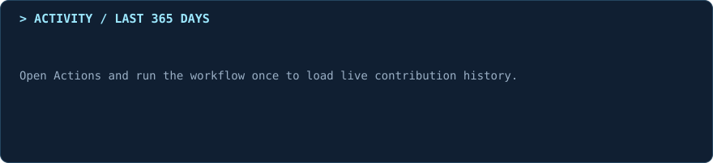

  

  I build software, games and tools that make things a little easier. 
  Star a repository if you find it useful!

  <a href="https://github.com/b8mi">GitHub</a>

  

## Projects

  
  
  
  

  

